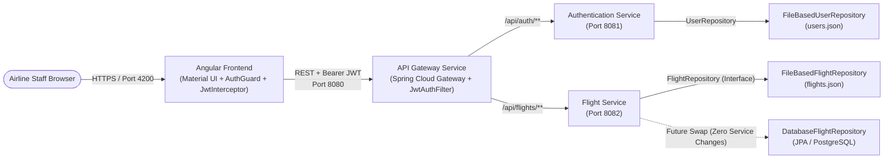
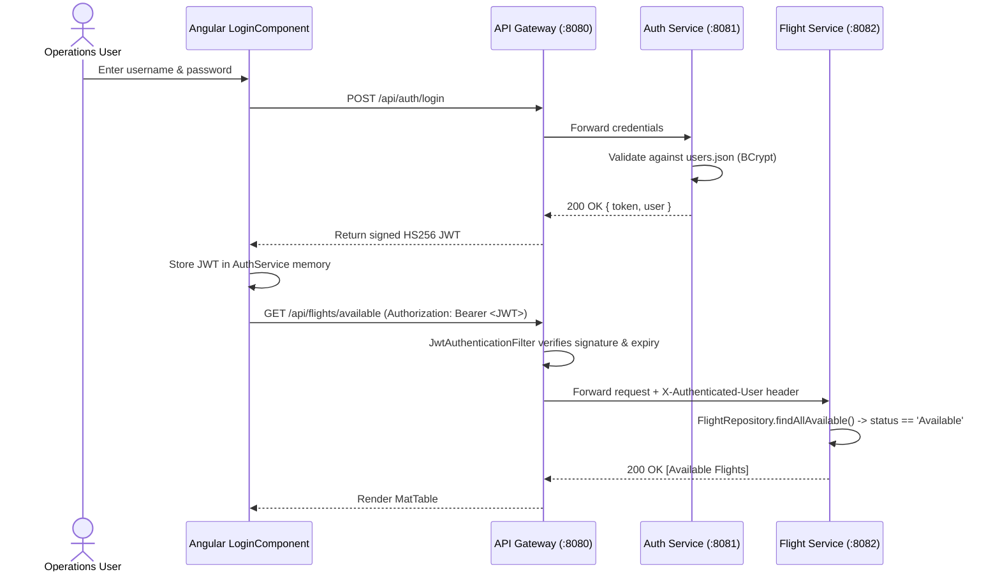

# SkyGrid Airline Flight Availability Portal — System Architecture

## 1. Microservices Architecture Diagram

## 2. JWT Authentication Flow

## 3. Repository Pattern & Future Database Migration

1. `FlightService` injects the `FlightRepository` interface (`List<FlightDto> findAllAvailable()`).
2. Currently, `FileBasedFlightRepository` is annotated with `@Repository` (or `@ConditionalOnProperty(name = "flight.storage.mode", havingValue = "file", matchIfMissing = true)`) and reads `flights.json` via Jackson `ObjectMapper`.
3. To migrate to PostgreSQL / MySQL later:
   - Implement `DatabaseFlightRepository implements FlightRepository` backed by Spring Data JPA.
   - Activate `DatabaseFlightRepository` via configuration (`flight.storage.mode=database`).
   - Zero changes required in `FlightService`, `FlightController`, `gateway-service`, or Angular frontend.
